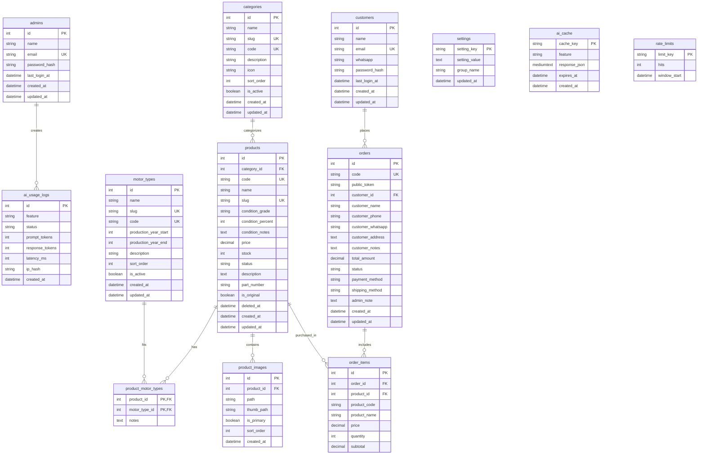

# Diagram Relasi Entitas (ERD) & Kamus Data — PEPSO PARTS

Dokumen ini mendokumentasikan skema basis data MariaDB 10.4.32 / MySQL untuk sistem **PEPSO PARTS**. Basis data terdiri dari 13 tabel terindeks dengan integritas relasional *Foreign Key*.

---

## 1. Diagram Relasi Entitas (Mermaid)

---

## 2. Kamus Data Rinci (Data Dictionary)

### 2.1 `admins`
Menyimpan akun administrator toko yang berhak mengelola sistem.
- `id` (INT, PK, Auto Increment)
- `name` (VARCHAR(100)): Nama lengkap admin.
- `email` (VARCHAR(150), UNIQUE): Email login.
- `password_hash` (VARCHAR(255)): Hash kata sandi Bcrypt.
- `last_login_at` (DATETIME): Waktu login terakhir.
- `created_at`, `updated_at` (DATETIME).

### 2.2 `categories`
Kelompok bagian suku cadang Kawasaki Ninja 2-Tak (Mesin, Pengapian, Bodi, dll.).
- `id` (INT, PK, Auto Increment)
- `name` (VARCHAR(100)): Nama kategori (contoh: Mesin & Blok).
- `slug` (VARCHAR(120), UNIQUE): URL slug (`mesin-blok`).
- `code` (VARCHAR(10), UNIQUE): Singkatan 3 huruf kode part (`MSN`, `IGN`, `KLP`, `KBR`, `BOD`).
- `description` (TEXT): Deskripsi kategori.
- `icon` (VARCHAR(50)): Nama ikon visual UI.
- `sort_order` (INT): Urutan tampil di katalog.
- `is_active` (TINYINT(1)): 1 = Tampil, 0 = Nonaktif.

### 2.3 `motor_types`
Varian motor Kawasaki Ninja 2-Tak yang didukung.
- `id` (INT, PK, Auto Increment)
- `name` (VARCHAR(100)): Nama varian (Ninja 150 RR, Ninja 150 R, Ninja 150 SS).
- `slug` (VARCHAR(100), UNIQUE): `ninja-rr`, `ninja-r`, `ninja-ss`.
- `code` (VARCHAR(20), UNIQUE): `KR150K`, `KR150L`, `KR150M`.
- `production_year_start` (INT), `production_year_end` (INT): Rentang tahun produksi.
- `is_active` (TINYINT(1)): Status aktif.

### 2.4 `products`
Entitas utama katalog suku cadang.
- `id` (INT, PK, Auto Increment)
- `category_id` (INT, FK -> `categories.id`)
- `code` (VARCHAR(50), UNIQUE): Format `PS-{CAT}-{NNN}` (contoh: `PS-MSN-001`).
- `name` (VARCHAR(200)): Nama barang lengkap.
- `slug` (VARCHAR(250), UNIQUE): URL slug SEO.
- `condition_grade` (ENUM): `excellent` (Mulus), `good` (Bagus), `fair` (Normal), `poor` (Minus).
- `condition_percent` (INT): Estimasi keutuhan kondisi fisik (70 - 100%).
- `condition_notes` (TEXT): Catatan minus/kondisi riil barang copotan.
- `price` (DECIMAL(12,2)): Harga jual dalam Rupiah (IDR).
- `stock` (INT): Kuantitas stok fisik barang.
- `status` (ENUM): `available` (Tersedia), `sold` (Terjual), `unavailable` (Disimpan/Draft).
- `description` (TEXT): Deskripsi spesifikasi suku cadang.
- `part_number` (VARCHAR(100)): Nomor part orisinil Kawasaki OEM (jika ada).
- `is_original` (TINYINT(1)): 1 = Orisinil / Cabutan bawaan motor, 0 = Aftermarket/Variasi.
- `deleted_at` (DATETIME, NULLABLE): Timestamp soft-delete barang.

### 2.5 `product_motor_types`
Tabel pivot relasi banyak-ke-banyak (Many-to-Many) antara produk dan jenis motor kompatibel.
- `product_id` (INT, FK -> `products.id`, PK bersama)
- `motor_type_id` (INT, FK -> `motor_types.id`, PK bersama)
- `notes` (TEXT): Catatan modifikasi pemasangan (contoh: PNP tanpa ubahan, perlu braket).

### 2.6 `product_images`
Galeri foto produk resolusi tinggi dan thumbnail WebP.
- `id` (INT, PK, Auto Increment)
- `product_id` (INT, FK -> `products.id`, ON DELETE CASCADE)
- `path` (VARCHAR(255)): URL foto besar (maksimal lebar 1600px).
- `thumb_path` (VARCHAR(255)): URL foto thumbnail cepat (maksimal 400px).
- `is_primary` (TINYINT(1)): 1 = Cover utama pada kartu produk.
- `sort_order` (INT): Urutan carousel slide.

### 2.7 `orders`
Transaksi pesanan belanja pelanggan.
- `id` (INT, PK, Auto Increment)
- `code` (VARCHAR(50), UNIQUE): Format nomor pesanan `PO-YYMMDD-XXXX`.
- `public_token` (VARCHAR(64)): Kunci token acak 64 karakter untuk pelacakan publik.
- `customer_name` (VARCHAR(100)): Nama pembeli.
- `customer_phone` (VARCHAR(25)): Nomor handphone.
- `customer_whatsapp` (VARCHAR(25)): Nomor WhatsApp ternormalisasi (`628xxxxxxxxx`).
- `customer_address` (TEXT): Alamat lengkap tujuan pengiriman.
- `customer_notes` (TEXT): Catatan pembeli (contoh: minta bubble wrap tebal).
- `total_amount` (DECIMAL(12,2)): Total nominal belanja.
- `status` (ENUM): `new` (Dibuat), `confirmed` (Dikonfirmasi), `shipped` (Dikirim), `completed` (Selesai), `cancelled` (Dibatalkan).
- `payment_method` (VARCHAR(50)): Metode pembayaran (`bank_transfer`, `cod_sentul`).
- `shipping_method` (VARCHAR(50)): Pilihan kurir (`jne_reg`, `jnt`, `ambil_di_bengkel`).
- `courier` (VARCHAR(100)): Nama kurir pengiriman.
- `tracking_number` (VARCHAR(100)): Nomor resi yang ditampilkan pada halaman lacak pesanan.
- `admin_received_notified_at` (DATETIME): Waktu admin meninjau konfirmasi barang diterima pelanggan.
- `admin_note` (TEXT): Catatan admin toko.

### 2.8 `order_items`
Rincian item barang di dalam sebuah pesanan.
- `id` (INT, PK, Auto Increment)
- `order_id` (INT, FK -> `orders.id`, ON DELETE CASCADE)
- `product_id` (INT, FK -> `products.id`)
- `product_code` (VARCHAR(50)): Snapshoot kode barang saat transaksi.
- `product_name` (VARCHAR(200)): Snapshoot nama barang saat transaksi.
- `price` (DECIMAL(12,2)): Snapshoot harga satuan barang saat dipesan.
- `quantity` (INT): Jumlah barang yang dibeli.
- `subtotal` (DECIMAL(12,2)): Subtotal harga (`price * quantity`).

### 2.9 `settings`
Pengaturan dinamis profil toko dan operasional.
- `setting_key` (VARCHAR(50), PK)
- `setting_value` (TEXT)
- `group_name` (VARCHAR(50)): `general`, `contact`, `store`.

### 2.10 `ai_cache`
Penyimpanan tembolok (cache) respon AI untuk efisiensi latensi dan penghematan kuota.
- `cache_key` (VARCHAR(64), PK): Hash MD5/SHA256 dari payload query.
- `feature` (VARCHAR(50)): `chat`, `search`, `compatibility`, `describe`.
- `response_json` (MEDIUMTEXT): Respon struktur JSON tersimpan.
- `expires_at` (DATETIME): Batas waktu kedaluwarsa tembolok.

### 2.11 `ai_usage_logs`
Pencatatan statistik dan telemetri pemanggilan layanan AI.
- `id` (INT, PK, Auto Increment)
- `feature` (VARCHAR(50))
- `status` (VARCHAR(20)): `success`, `fallback_mock`, `error`.
- `prompt_tokens`, `response_tokens` (INT)
- `latency_ms` (INT): Waktu respon pemrosesan dalam milidetik.
- `ip_hash` (VARCHAR(64)): Hash SHA-256 IP klien untuk anonimitas privasi.

### 2.12 `rate_limits`
Pelacak frekuensi akses IP untuk proteksi brute-force login.
- `limit_key` (VARCHAR(100), PK): Kunci identitas per IP dan aksi.
- `hits` (INT): Jumlah percobaan dalam jendela waktu aktif.
- `window_start` (DATETIME): Waktu awal pembukaan jendela pembatasan.

### 2.13 `customers`
Akun pelanggan untuk masuk, mendaftar, dan melihat riwayat pesanan.
- `id` (BIGINT, PK, Auto Increment)
- `name` (VARCHAR(100)): Nama pelanggan.
- `email` (VARCHAR(150), UNIQUE): Email untuk masuk.
- `whatsapp` (VARCHAR(30)): Nomor WhatsApp akun.
- `password_hash` (VARCHAR(255)): Hash kata sandi Bcrypt.
- `last_login_at`, `created_at`, `updated_at` (DATETIME).
- `orders.customer_id` menghubungkan pesanan ke akun dan menjadi `NULL` bila akun dihapus.

